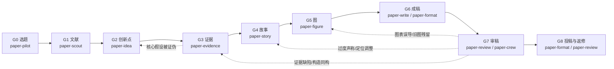

# paper-skills

一套面向“研究者 + 多 AI Agent”协作撰写顶刊与顶会论文的 Claude Code 技能集，覆盖从选题（G0）到投稿返修（G8）的全流程。

[English](README_EN.md) | [一页流程](docs/workflow.md) | [真实教训全集](docs/lessons.md)

## 项目由来

这套技能不是凭空设计的理论框架，而是从一次完整的真实科研实战中提炼出来的。一位研究者带着多模型 AI 团队从零开始推进 LLM Agent 记忆方向的顶刊论文，完整经历了检索 684 篇文献、精读 180 张卡片、多轮查新、仿真信号实验被推翻重做，以及五章并行外包拼出 45 页初稿后被三方审稿人一致打 3/10 拒稿、被导师判为“灾难”并推倒重来的全过程。

每条检查门、每个反例清单和每道交付把关，都对应一次真实踩过的坑。把这些教训结构化为可复用的技能，目的是让研究者在借助 AI 提速的同时，不丢失科学严谨性与论文质量。

## 七条核心原则

1. 先论证，后成文：没有一句话核心主张、贡献-证据对照表和每节一句话目的，不开始写正文。
2. 主张不超过证据：每条主张必须指向具体实验或数据；尚未做到的能力写成局限或未来工作，不写进题目和摘要。
3. 真实信号优先：评测中任何由真值生成的信号、阈值或关键词先验都要标记并剔除；严格预注册切分；防范测试样本按方法检测谓词构造出来的“构造同构”。
4. 一张图一个信息：先写出这张图希望读者记住的一句话，再下笔绘制。图 1 必须是具体实例 teaser，而非塞满文字的方框流程图。
5. 交付门：任何交给人审阅的稿件，必须经过通读全文、至少两家不同模型独立盲审和致命问题清零；交付说明需如实写明读过哪些部分。
6. 作者是作者：研究问题、创新点取舍、论文定位与投稿去向由人拍板，AI 只提供证据、备选方案与反方意见。
7. 格式即可信度：直接使用目标期刊或会议的官方模板（LaTeX 优先），内部工程代号不进入正文，参考文献逐条核验。

## 阶段门流程（G0–G8）

`paper-pilot` 负责管理以下九道阶段门。任何下游阶段若暴露上游缺陷（例如审稿发现主张越界或实验构造同构），均允许并要求按虚线回退，在 `status.md` 中留档后重走。



## 10 个技能总览

| 技能 | 对应阶段 | 一句话职责 | 主要产出 |
|---|---|---|---|
| `paper-pilot` | 全程（G0–G8） | 总入口：判断项目阶段、维护进度表、执行门控与回退路由 | `status.md`、门控记录 |
| `paper-scout` | G1 / G2 | 文献检索、去重、论文矩阵维护、精读卡片与查新 | `paper_matrix.csv`、`cards/`、查新报告 |
| `paper-idea` | G2 | 从“瓶颈 × 方法”交叉矩阵发掘创新点、打分并做反方质询 | 创新点池、三选一提案 |
| `paper-evidence` | G3 | 实验设计与诚信核查：泄漏、仿真信号、预注册切分、同构与统计检验 | 实验协议、`claim-evidence` 表、复核报告 |
| `paper-story` | G4 | 构建论证骨架：一句话主张、贡献-证据表、章节目的与命名表 | `outline.md`（8 页以内骨架稿） |
| `paper-figure` | G5 | 图清单规划、实例 teaser 与架构图规范、数据图风格统一与看图验收 | `figure_plan.md`、图表与绘图脚本 |
| `paper-write` | G6 | 按骨架起草正文、中英互译、润色、去 AI 味与术语代号一致性检查 | 章节正文 |
| `paper-format` | G6 / G8 | 期刊/会议格式档案、LaTeX 模板落地、Word 讨论稿导出与投稿前检查 | 可编译手稿、格式核验清单 |
| `paper-review` | G7 / G8 | 多模型对抗式独立审稿、元审稿汇总、改稿计划与逐条回复审稿意见 | `review_*.md`、`meta_review.md`、`response.md` |
| `paper-crew` | 横向协作 | 研究者与多模型分工编排、任务单模板与强制交付门把关 | 任务单、交付说明、验收记录 |

## 安装方法

直接将本仓库 `skills/` 目录下的技能文件夹复制到 Claude Code 的技能目录中。务必保留每个技能的完整目录结构（同时包含 `SKILL.md` 和 `references/`），不要只复制单个 `SKILL.md`。

全局安装（对所有项目生效）：

```bash
mkdir -p ~/.claude/skills
cp -r skills/* ~/.claude/skills/
```

项目级安装（仅对当前论文仓库生效）：

```bash
mkdir -p .claude/skills
cp -r /path/to/paper-skills/skills/* .claude/skills/
```

Windows PowerShell 示例（全局安装）：

```powershell
New-Item -ItemType Directory -Force -Path "$HOME\.claude\skills" | Out-Null
Copy-Item -Recurse -Force .\skills\* "$HOME\.claude\skills\"
```

安装完成后，在论文工作目录启动 Claude Code，直接调用 `paper-pilot` 盘点当前进度并生成 `status.md` 即可开始。更多流程细节见 [docs/workflow.md](docs/workflow.md)，完整踩坑案例见 [docs/lessons.md](docs/lessons.md)。

## 致谢与参考来源

本项目在方法论设计上参考了三个开源科研技能仓库，仅吸收其设计原则，所有技能正文、模板与清单均为独立编写，未复制原仓库文本或照搬其结构命名：

- `awesome-ai-research-writing`：吸收了四段式任务约束（角色、任务、约束、自查）、配图追求扁平留白与短标签的理念，以及审稿时区分“表述问题”与“方法缺陷”并评估“可救性”的方法。
- `academic-research-skills`：吸收了阶段间强制检查点、作者始终掌舵、将诚信核查与多轮审稿纳入主流程的设计原则。该仓库采用 CC BY-NC 许可，本项目完全独立重写，未复用其文字内容。
- `nature-skills`：吸收了入口技能只做路由、按需加载轻量参考片段的架构思路，以及将写作、润色与返修回复拆分为独立职责的做法。

## 许可协议

本项目采用 MIT 许可协议开源，详见 [LICENSE](LICENSE)。
