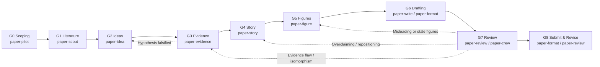

# paper-skills

A Claude Code skill suite for collaborative academic paper writing between a human researcher and multiple AI agents, covering every stage from topic scoping (G0) to submission and rebuttal (G8).

[中文版](README.md) | [One-Page Workflow](docs/workflow.md) | [Field Lessons](docs/lessons.md)

## Origin

This suite grew out of a real end-to-end research project rather than abstract guidelines. A researcher worked with multiple AI agents from scratch on a top-venue paper on LLM agent memory. Along the way, the project went through 684 retrieved papers, 180 structured reading cards, novelty checks, overturned experiments caused by synthetic evaluation signals, and a 45-page stitched draft assembled from parallel chapter outsourcing that received unanimous 3/10 reject scores and was called a disaster before being rebuilt.

Every gate, checklist, and failure case in this repository encodes a lesson paid for in real rework. The goal is to let AI accelerate execution without letting speed erode scientific rigor.

## Seven Core Principles

1. Argument before prose: do not draft main text without a one-sentence core claim, a claim-evidence table, and a one-sentence purpose for each section.
2. Claims never exceed evidence: every claim must map to a concrete experiment or number. Unfinished capabilities belong in limitations or future work, never in the title or abstract.
3. Real signals first: flag and remove any evaluation signal, threshold, or keyword prior derived from ground truth or test-set peeking. Pre-register splits and check for construction isomorphism (test failures engineered to match the detector's own predicate).
4. One message per figure: write the single takeaway sentence before drawing. Figure 1 must be a concrete worked example (teaser), not a text-heavy box-and-arrow diagram.
5. Delivery gate: any manuscript handed to a human reader must pass a full read-through, independent reviews from at least two distinct model families, and zero unresolved fatal flaws. Every delivery note must state explicitly which sections were read in full.
6. The author stays the author: research questions, novelty trade-offs, paper positioning, and target venues are human decisions. AI supplies evidence, structured options, and adversarial critiques.
7. Formatting is credibility: write directly in the target venue template (LaTeX first), keep internal engineering codenames out of the manuscript, and verify every reference entry.

## Stage-Gate Workflow (G0–G8)

`paper-pilot` governs nine explicit gates. Whenever a downstream check exposes an upstream flaw (such as claim overreach or construction isomorphism during review), the workflow rolls back along the dashed edges and logs the reason in `status.md`.



## Overview of the 10 Skills

| Skill | Stage | Responsibility | Primary Outputs |
|---|---|---|---|
| `paper-pilot` | G0–G8 | Main router: diagnose project stage, maintain `status.md`, enforce gates and rollbacks | `status.md`, gate records |
| `paper-scout` | G1 / G2 | Multi-source search, deduplication, paper matrix, reading cards, novelty checks | `paper_matrix.csv`, `cards/`, novelty report |
| `paper-idea` | G2 | Bottleneck-by-method matrix ideation, scoring, and adversarial interrogation | Idea pool, 3-to-1 proposal |
| `paper-evidence` | G3 | Experiment integrity: leakage, synthetic signals, pre-registered splits, isomorphism, statistics | Experiment protocol, claim-evidence table, audit report |
| `paper-story` | G4 | Argument skeleton: one-sentence claim, claim-evidence mapping, section purposes, naming table | `outline.md` (within 8 pages) |
| `paper-figure` | G5 | Figure planning, worked-example teaser and architecture rules, unified visual styling, visual QA | `figure_plan.md`, figures and plotting scripts |
| `paper-write` | G6 | Skeleton-guided drafting, bilingual translation, polishing, de-AI-fying, terminology checks | Section drafts |
| `paper-format` | G6 / G8 | Venue formatting profiles, LaTeX template setup, internal Word export, pre-submission checks | Compilable manuscript, format checklist |
| `paper-review` | G7 / G8 | Multi-model blind adversarial reviews, meta-review synthesis, revision plans, point-by-point rebuttal | `review_*.md`, `meta_review.md`, `response.md` |
| `paper-crew` | Cross-stage | Human + multi-agent task allocation, structured task briefs, and mandatory delivery gate | Task briefs, delivery notes, acceptance logs |

## Installation

Copy the skill folders under `skills/` into your Claude Code skills directory. Always copy each full folder (including `SKILL.md` and `references/`), not `SKILL.md` alone.

Global installation (available across all projects):

```bash
mkdir -p ~/.claude/skills
cp -r skills/* ~/.claude/skills/
```

Project-local installation (scoped to one paper repository):

```bash
mkdir -p .claude/skills
cp -r /path/to/paper-skills/skills/* .claude/skills/
```

Windows PowerShell example (global installation):

```powershell
New-Item -ItemType Directory -Force -Path "$HOME\.claude\skills" | Out-Null
Copy-Item -Recurse -Force .\skills\* "$HOME\.claude\skills\"
```

Once installed, open Claude Code in your paper directory and invoke `paper-pilot` to audit current progress and initialize `status.md`. See [docs/workflow.md](docs/workflow.md) for the one-page workflow and [docs/lessons.md](docs/lessons.md) for the full collection of real-world lessons.

## Acknowledgments

This project draws high-level design inspiration from three open-source research skill repositories. Only principles were absorbed; all skill instructions, templates, and checklists were written from scratch without copying original text or mirroring their structural naming:

- [awesome-ai-research-writing](https://github.com/Leey21/awesome-ai-research-writing): four-part prompt discipline (role, task, constraints, self-check), flat low-clutter diagram aesthetics with short labels, and separating presentation issues from methodological flaws while assessing salvageability during review.
- [academic-research-skills](https://github.com/Imbad0202/academic-research-skills): mandatory checkpoints between phases, keeping the human researcher as the sole decision-making author, and integrating integrity audits plus multi-round review into the main pipeline. Because that repository uses a CC BY-NC license, zero text was copied.
- [nature-skills](https://github.com/Yuan1z0825/nature-skills): router-first entry architecture with on-demand reference loading, and separating drafting, polishing, and reviewer-response responsibilities.

## License

Released under the MIT License. See [LICENSE](LICENSE).
